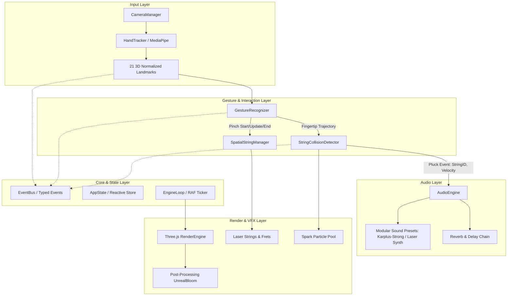

# 🎵 Spatial Harp — Architecture, Roadmap & Implementation Guide

A real-time, browser-based **Augmented Reality Harp & Audio-Visual Instrument** powered by webcam hand tracking, Three.js WebGL rendering, and Web Audio/Tone.js synthesis. Built with **TypeScript** using a strictly modular, decoupled architecture.

Reference video: [files/sample.mp4](file:///home/mk/Files/JS/02-hand/files/sample.mp4).  
Codebase ↔ Functionality Mindmap: [docs/mindmap.md](./mindmap.md).

---

## 🚦 Roadmap & Milestone Progress Tracker

| Step | Milestone | Status | Key Deliverables & Summary |
| :---: | :--- | :---: | :--- |
| **Step 1** | **Core Foundation & Skeleton Tracking** | ✅ **COMPLETED** | Mirrored camera feed, offline MediaPipe WASM/model, 21-joint 3D skeleton (red joints, green bones), HUD. |
| **Step 2** | **Pinch Detection & Dynamic Elastic String** | ✅ **COMPLETED** | Hysteresis pinch detection, dual-hand elastic string, ruler/fret tick marks, animated anchor reticles. |
| **Step 3** | **Mid-Air Spatial String Anchoring** | ✅ **COMPLETED** | Releasing pinch drops persistent 3D strings with fret/ruler tick marks in space; build multi-string harp. |
| **Step 4** | **Real-Time Audio Synthesis & Plucking Engine** | ✅ **COMPLETED** | Finger-string collision solver, velocity-sensitive plucking, Karplus-Strong string synthesis. |
| **Step 5** | **Visual Physics, Wave Oscillation & Sparks** | ✅ **COMPLETED** | Damped harmonic wave equations on plucked strings, GPU spark particle burst, UnrealBloom glow. |
| **Step 6** | **Modular Sound Presets & Instrument Settings** | ✅ **COMPLETED** | Multi-engine sound synthesizer (Harp, Laser Synth, Ambient Chime, Retro 8-Bit) & 5 musical scale modes (Pentatonic, Minor, Hirajōshi, Major, Blues). |
| **Step 7** | **Advanced Plucking Visual Effects & Wave Envelopes** | ✅ **COMPLETED** | Resonant dual-wave envelope sheath (spindle oscillation), contact shockwaves, streak sparks, crosshair anchor reticles. |
| **Step 8** | **Glassmorphic UI Suite & Mobile/Tablet Responsiveness** | ✅ **COMPLETED** | Navigation bar, Sound Studio drawer, real progress splash screen, centralized JetBrains Mono typography, safe-area & cross-device responsive layout. |
| **Step 9** | **One-Hand Accessibility Mode & Settings Drawer** | ✅ **COMPLETED** | Default One-Hand Mode (Pinch-Drag-Release string creation), SplashScreen & SettingsPanel (`⚙️`) mode toggles, 3s + `3-2-1` auto-fallback countdown in Two-Hand Mode, `localStorage` persistence, and unit tests. |

---

## 🏛️ System Architecture



### Key Architectural Tenets:
- **TypeScript First**: Strict type definitions for landmarks, gestures, audio presets, and instrument contracts.
- **Progressive Step-by-Step Delivery**: Start with foundation, verify together at each stage, then advance.
- **Modular Audio Engine**: Swappable sound presets (Karplus-Strong physical plucked string, Sci-Fi Laser Synth, FM Chime) selectable at runtime.
- **Future-Proof Scalability**: Plugin-style instrument architecture (`BaseInstrument`) allowing future additions (air drums, theremins, spatial controls).

---

## 📁 Project Directory Scaffold

```
02-hand/
├── .github/
│   └── workflows/
│       ├── ci.yml              # CI test suite & production build check on push/PR to main
│       └── release.yml         # Automated GitHub Release publisher & tagger on push to release
├── AGENTS.md                   # Strict guidelines & architectural rules for AI agents
├── README.md                   # Root project overview & quickstart
├── package.json                # Dependencies: three, @mediapipe/tasks-vision, tone
├── tsconfig.json               # Strict TypeScript configuration
├── vite.config.ts              # Vite dev server (LAN host + basic-ssl HTTPS) & build settings (injects __APP_VERSION__)
├── vercel.json                 # Vercel SPA rewrites & WASM/model caching headers
├── public/
│   ├── config.json             # External grouped runtime configuration (vision, pinch, strings, plucking, audio, visuals, ui)
│   ├── models/                 # Offline MediaPipe hand_landmarker.task (7.8 MB)
│   └── wasm/                   # Offline vision_wasm binaries
├── files/                  # Local reference media (git-ignored, personal reference)
│   ├── sample.mp4              # Original reference demo
│   └── steps/                  # Step tutorial graphics source
├── docs/
│   ├── documentation.md        # Consolidated architecture, roadmap & walkthrough
│   └── mindmap.md              # Codebase ↔ App Functionality mindmap & matrix
├── tests/
│   ├── audio/                  # ScaleMapper & Mersenne's Law acoustic pitch tests
│   ├── gestures/               # PinchDetector hysteresis & string collision tests
│   ├── instruments/            # SpatialStringManager one-hand & two-hand anchoring tests
│   └── core/                   # EventBus & AppConfig integrity tests
└── src/
    ├── main.ts                 # Application bootstrapper & loop wiring
    ├── types/
    │   ├── env.d.ts            # Global compile-time environment typings (__APP_VERSION__)
    │   ├── vision.ts           # HandPose, Landmark, Bone connections
    │   ├── gestures.ts         # PinchState, DualPinchState, HandGestureState
    │   ├── instruments.ts      # AnchoredString, EndpointGrabState, HandInteractionMode, StringPreviewState, SpatialStringConfig
    │   ├── audio.ts            # PluckEvent, AudioFxParams, DelayTimeDivision, AudioEngineConfig
    │   └── physics.ts          # StringVibrationState, SparkParticle, ShockwaveState
    ├── core/
    │   ├── config.ts           # Typed AppConfig defaults, /config.json loader & localStorage overrides
    │   ├── event-bus.ts        # Typed pub/sub event bus
    │   └── loop.ts             # High-precision RAF ticker with delta time
    ├── vision/
    │   ├── camera-manager.ts   # Webcam capture, mirroring, aspect handling
    │   ├── hand-tracker.ts     # MediaPipe HandLandmarker wrapper
    │   └── smoothing-filter.ts # Exponential smoothing to eliminate jitter
    ├── gestures/
    │   ├── pinch-detector.ts   # Hysteresis pinch recognition & dual-hand detection
    │   └── string-collision-detector.ts # Swept trajectory crossing & fingertip plucking solver
    ├── instruments/
    │   └── spatial-string-manager.ts # Mid-air anchoring state machine, harp manager & endpoint grabbing
    ├── audio/
    │   ├── scale-mapper.ts     # Spatial harp string sorting and 5 musical scale definitions
    │   └── audio-engine.ts     # Multi-engine synthesizer (Karplus-Strong, Laser Synth, FM Chime, Retro 8-Bit) & FX chain
    ├── render/
    │   ├── scene-manager.ts    # WebGLRenderer, Camera, EffectComposer & UnrealBloomPass
    │   ├── video-background.ts # Mirrored video feed container
    │   ├── skeleton-view.ts    # 21-node hand skeleton visualizer
    │   ├── dynamic-string-view.ts # Elastic string preview, frets & anchor reticles
    │   ├── anchored-strings-view.ts # Persistent harp strings, dual-wave envelopes & precision crosshairs
    │   ├── pluck-shockwave-pool.ts # Zero-GC expanding 3D contact shockwave ripple pool
    │   └── spark-particle-pool.ts # Zero-GC GPU multi-form spark & floating mote pool (256 Points)
    └── ui/
        ├── hud.ts              # Collapsible diagnostics card (FPS, gestures, active strings) styled with centralized design tokens (JetBrains Mono)
        ├── nav-bar.ts          # Floating glassmorphic top navigation bar with brand logo, tab routing, diagnostics toggle & clear strings action
        ├── sound-studio-panel.ts # Dedicated Sound Studio drawer panel (synthesizer presets, musical scales, live Reverb/Delay FX rack)
        ├── settings-panel.ts   # Glassmorphic Settings & Accessibility drawer (One-Hand / Two-Hand Mode toggle, live hints toggle)
        ├── tutorial-modal.ts   # Optional 4-step interactive gesture tutorial modal (toggled via ui.showTutorialOnStart)
        ├── hand-prompt.ts      # Live step-by-step hand coach pill with 3s + 3-2-1 single-hand auto-switch countdown
        └── splash-screen.ts    # Atmospheric glassmorphic intro splash screen with Hand Mode quick toggle, integrated button progress/spinner loader, gesture cards & compact privacy notice
```

---

## 🛠️ Implementation Walkthrough by Milestone

### Step 1: Core Foundation & Skeleton Tracking (✅ Completed)

1. **Vision Pipeline**:
   - `camera-manager.ts`: Handles webcam permissions, 720p/1080p stream capture, and aspect-ratio preservation.
   - `hand-tracker.ts`: Integrates MediaPipe `HandLandmarker` running completely locally (using local WASM and offline models in `/public`). Supports simultaneous dual-hand tracking with edge-of-screen partial hand retention (`minHandDetectionConfidence: 0.30`, `minHandPresenceConfidence: 0.25`, `minTrackingConfidence: 0.25`).
   - `smoothing-filter.ts`: Exponential moving average smoother that removes hand landmark tremor without introducing lag.

2. **Rendering Layer**:
   - `video-background.ts`: Renders the mirrored webcam feed directly beneath the WebGL canvas with zero GPU copy overhead.
   - `scene-manager.ts`: Orthographic normalized Three.js scene aligning WebGL coordinates 1:1 with screen video pixels.
   - `skeleton-view.ts`: Pre-allocated zero-GC joint/bone pool rendering hand landmarks (fingertips-only by default via `visuals.skeletonFingertipsOnly`, or full 21-node skeleton) and optional connecting bones (`visuals.skeletonShowBones`), with palm-span-proportional joint scaling (configurable via `visuals.skeleton*` in `public/config.json`) and highlighted index/thumb fingertips.

3. **Core Engine & UI**:
   - `loop.ts`: High-precision `requestAnimationFrame` ticker with delta time and FPS tracking.
   - `event-bus.ts`: Decoupled typed publish/subscribe event bus.
   - `hud.ts`: Floating HUD displaying real-time FPS, detected hands count, and tracking confidence.

---

### Step 2: Pinch Detection & Dynamic Elastic String (✅ Completed)

1. **Pinch Gesture Recognizer** (`pinch-detector.ts`):
   - Calculates 3D distance between Thumb tip (`#4`) and Index tip (`#8`).
   - Implements **hysteresis thresholding** (`pinchThreshold: 0.055`, `releaseThreshold: 0.080`) to eliminate flickering at transition boundaries.
   - Computes normalized pinch midpoint and pinch strength for single-hand and dual-hand interaction.

2. **Dynamic Laser String Visualizer** (`dynamic-string-view.ts`):
   - **Anchor Rings**: Rotating, glowing cyan/white concentric rings attached to the fingertips when pinching.
   - **Elastic Laser Line**: Glowing white-cyan laser line spanning between both hands when both hands pinch.
   - **Graduated Ruler Tick Marks**: Perpendicular tick marks (matching the video at `00:01 - 00:04`) spaced along the string with highlighted center and octave notches.

3. **Enhanced HUD** (`hud.ts`):
   - Real-time gesture status: `Open Hand`, `Pinch (Left/Right)`, or `Dual Pinch (Elastic String)`.
   - Instructional prompts guiding user actions.

---

### Step 3: Mid-Air Spatial String Anchoring (✅ Completed)

1. **Spatial String Manager & Anchoring State Machine** (`spatial-string-manager.ts`):
   - Detects the transition when a user releases a dual-hand pinch.
   - **Endpoint Re-Grabbing & Repositioning**: Users can pinch near any anchored string tip ($P_1$ or $P_2$) within screen-plane `(dx, dy)` proximity (`grabProximityThreshold: 0.045`, `grabPinchDistance: 0.052`, `grabDwellMs: 35ms`, `maxGrabHandSpeed: 1.10`) to grab and dynamically drag, stretch, or rotate the string in 3D mid-air. Supports simultaneous two-hand dual tip manipulation while rejecting accidental snags from pinches started far away in the middle of the harp. Releasing the pinch commits the string to its new position.
   - **Motion-Blur & Flicker Debounce**: Includes a 120ms release grace window (`releaseGraceMs: 120`) and 350ms cooldown (`cooldownMs: 350`) that prevents fast hand movements or momentary webcam motion blur from spawning accidental duplicate strings.
   - Enforces a minimum distance threshold ($\ge 0.10$ normalized distance) and minimum stretch duration ($150\text{ ms}$) to filter accidental gestures.
   - Stores up to 12 strings simultaneously (FIFO replacement when exceeding max capacity).
   - Cycles through a harmonious 8-color neon laser palette (`#00f0ff` Cyan, `#38ef7d` Emerald, `#9b51e0` Violet, `#ff007f` Pink, etc.).
   - Dispatches `string:anchored`, `string:grabbed`, `string:reanchored`, `string:removed`, and `string:cleared` events across the `EventBus`.

2. **Zero-GC Anchored Strings View** (`anchored-strings-view.ts`):
   - Pre-allocated Three.js pools: 12 laser lines, 12 fret tick line segments (up to 30 ticks each), and 24 glowing circular end-cap anchor nodes.
   - **Grab Halo Visual Feedback**: When an endpoint is grabbed, its node scales up to $1.8\times$ with an intensified glowing white halo, dynamically updating the string orientation and fret ticks in real time.
   - Reusable scratch vectors eliminate per-frame allocations during `update()`.
   - Subtle breathing pulse on passive anchor nodes for tactile spatial presence.

3. **Optimized Dynamic String Preview** (`dynamic-string-view.ts`):
   - Refactored perpendicular normal and tick calculations to use pre-allocated scratch vectors, eliminating all runtime garbage collection allocations.

4. **HUD Controls & Keyboard Shortcuts** (`hud.ts`, `main.ts`):
   - HUD displays active string counter (`Strings: X / 12`).
   - Integrated `"Clear [C]"` glassmorphic button in the HUD.
   - Bound keyboard shortcuts (`C` or `Space`) to clear all anchored strings.

---

### Step 4: Real-Time Audio Synthesis & Plucking Engine (✅ Completed)

1. **Collision & Trajectory Crossing Solver** (`string-collision-detector.ts`):
   - **Anti-Tunneling Swept-Segment Intersection**: Calculates 2D line-segment crossing between each plucking finger's trajectory segment ($F_{t-1} \rightarrow F_t$) and string segments ($P_1 \rightarrow P_2$) with depth tolerance ($|\Delta z| \le 0.55$).
   - **Natural Multi-Finger Hysteresis Contact Latch & Tip Dead-Zone**: Engages when an approaching finger crosses or enters the string body ($r_{\text{touch}} \le 0.036$) while excluding a minimal dead-zone right on both string tip reticles ($r_{\text{tip}} < 0.016$ or outer $2\%$ span $t \notin [0.02, 0.98]$). Latches all touching fingers (`activeTouches`) so holding one or multiple fingers on a string never auto-repeats, requiring fingers to leave the hysteresis release zone ($r_{\text{release}} > 0.054$) before re-arming.
   - **Velocity Sensitivity**: Measures motion displacement over delta time, mapping hand speed to realistic acoustic velocity ($0.35 \dots 1.0$).
   - **Multi-Finger Strumming**: Tracks all 5 fingertips (`#4, #8, #12, #16, #20`) with a $65\text{ ms}$ finger cooldown and $50\text{ ms}$ per-string cooldown.
   - Ignores plucking from hands actively grabbing an endpoint to prevent accidental plucks.

2. **Acoustic Karplus-Strong Audio Engine** (`audio-engine.ts`):
   - Polyphonic pool of 8 `Tone.PluckSynth` instances executing physical Karplus-Strong string synthesis (tuned feedback delay line excited by attack noise burst).
   - Logarithmic velocity attenuation (`Tone.gainToDb`) for authentic acoustic dynamic range.
   - Spatial AR ambience FX chain: `Tone.FeedbackDelay (8n., 0.22 wet)` $\rightarrow$ `Tone.Reverb (2.6s decay, 0.30 wet)` $\rightarrow$ `Tone.Limiter (-1.0 dB)`.
   - Web Audio unlocking via user interaction (`Tone.start()`).

3. **Acoustic Length-to-Pitch Scale Mapper** (`scale-mapper.ts`):
   - Maps string pitch inversely from physical 3D string length ($L_{\text{norm}} \in [0.10, 0.82]$), obeying Mersenne's Law of acoustic strings (shorter strings produce higher treble pitches; longer strings produce deeper bass pitches).
   - Resizing a string dynamically shifts its musical note across a 3-octave scale (`C3` to `E6`), with live HUD pitch readout while dragging string endpoints and sound triggered only when a finger plucks the string.

4. **HUD Audio Controls & Live Feedback** (`hud.ts`, `main.ts`):
   - Audio unlock badge: `Audio: 🔇 Click to Enable` $\rightarrow$ `Audio: 🔊 Active`.
   - Real-time last pluck readout with note and velocity percentage: `Last Pluck: G4 (82%)`.

---

### Step 5: Visual Physics, Vibrations & Particle Sparks (✅ Completed)

1. **Damped Harmonic Standing Wave Equations** (`anchored-strings-view.ts`, `physics.ts`):
   - Tessellates each anchored string into **32 linear segments (33 vertices)**.
   - On pluck, simulates coupled fundamental and 2nd harmonic standing wave oscillations:
     $$y(u, t) = A_0 \sin(\pi u) \cos(\omega t) e^{-\gamma t} + \frac{A_0}{2} \sin(2\pi u) \cos(2\omega t) e^{-1.6\gamma t}$$
   - Vertices and fret tick marks displace dynamically along the string's perpendicular normal vector ($\omega = 28\text{ rad/s}, \gamma = 3.6$), decaying smoothly over $\sim 900\text{ ms}$ in sync with acoustic audio decay.

2. **GPU Spark Particle Burst Pool** (`spark-particle-pool.ts`):
   - Pre-allocated zero-GC pool of 256 `THREE.Points` with dynamic position and color attributes.
   - On pluck, erupts a radial burst of 20–25 sparks from the exact contact point along the string's normal hemisphere.
   - Particles inherit the string's laser color and simulate velocity, gravity ($g = -1.1$), air drag ($\times 0.94$), and alpha decay ($350\text{–}700\text{ ms}$).

3. **Neon Sci-Fi UnrealBloom Glow** (`scene-manager.ts`):
   - Post-processing pipeline with `EffectComposer`, `RenderPass`, `UnrealBloomPass` (strength: 1.25, radius: 0.45, threshold: 0.16), and `OutputPass`.
   - Uses HalfFloat RGBA render target with zero clear alpha, preserving camera webcam feed transparency while giving laser strings, anchor reticles, and sparks an intense neon bloom halo.

---

### Step 6: Modular Presets & Instrument Settings (✅ Completed)

1. **Multi-Engine Synthesizer Architecture** (`audio-engine.ts`, `types/audio.ts`):
   - **Zero-Leak Round-Robin Voice Pools**: `Plucked Harp` uses a pre-allocated `Tone.PluckSynth` pool, while `Laser Synth`, `Ambient Chime` (16 voices), and `Retro 8-Bit` lazily allocate voices on demand after audio unlock and recycle them round-robin, preventing both startup Web Audio bloat and `Tone.PolySynth` voice exhaustion/leaks during rapid multi-finger strumming.
   - **Plucked Harp (Acoustic)**: Polyphonic Karplus-Strong physical modeling (`Tone.PluckSynth` pool) with dynamic resonance and attack noise. Ambience: $2.8\text{ s}$ reverb ($30\%$ wet), $8\text{n.}$ dotted delay ($12\%$ wet).
   - **Laser Synth (Sci-Fi)**: Pre-allocated sawtooth synthesizer pool (`Tone.Synth`) with fast attack ($5\text{ ms}$) and snappy decay, coupled with resonant space delay ($32\%$ wet, $38\%$ feedback).
   - **Ambient Chime (FM Bell)**: Native Web Audio API one-shot FM bell engine (inharmonic ratio $3.01$, velocity-sensitive modulation index $12$, $1.55\text{ s}$ decay tail, 16-voice soft fade-out cap) routed into the Tone.js FX chain, eliminating `Tone.PolySynth` / `OneShotSource.cancelStop()` dropouts during rapid strumming.
   - **Retro 8-Bit (Arcade)**: Pre-allocated square wave chiptune synth pool (`Tone.Synth`) with ultra-fast attack ($2\text{ ms}$) and punchy decay for authentic arcade transients.
   - **Adaptive Dynamic FX Chain**: Switching presets smoothly reconfigures `Tone.FeedbackDelay` and `Tone.Reverb` parameters (or restores per-preset user overrides from the Sound Studio FX rack).

2. **Harmonic Scale Library** (`scale-mapper.ts`):
   - **C Major Pentatonic**: Consonant, peaceful harmonic scale (`C4, D4, E4, G4, A4, C5, D5, E5, G5, A5, C6, D6`).
   - **C Minor Pentatonic**: Moody, introspective, and soulful ambient scale (`C4, Eb4, F4, G4, Bb4, C5, Eb5, F5, G5, Bb5, C6, Eb6`).
   - **Hirajōshi (Japanese)**: Traditional exotic Japanese koto pentatonic tuning (`C4, Db4, F4, Gb4, Bb4, C5, Db5, F5, Gb5, Bb5, C6, Db6`).
   - **C Major Diatonic**: Bright, classical European 7-note diatonic scale (`C4, D4, E4, F4, G4, A4, B4, C5, D5, E5, F5, G5`).
   - **Blues Hexatonic**: Gritty blues scale featuring the expressive flat-fifth blue note (`C4, Eb4, F4, Gb4, G4, Bb4, C5, Eb5, F5, Gb5, G5, Bb5`).

3. **Interactive Instrument HUD Controls** (`hud.ts`, `main.ts`):
   - Integrated sleek, glassmorphic dropdown pickers (`#hud-preset-select`, `#hud-scale-select`) into the live HUD overlay.
   - Event listeners instantly reconfigure synthesis and scale mapping without interrupting the 60 FPS animation ticker or dropping active strings.

---

### Step 7: Advanced Plucking Visual Effects & Resonant Wave Envelopes (✅ Completed)

1. **Multi-Layered Glowing Laser Beam & Bi-Directional Propagating Energy Waves** (`anchored-strings-view.ts`, `dynamic-string-view.ts`):
   - **3-Layer Additive Laser Beam Assembly**: Each string renders (1) a blazing white-hot plasma core ribbon ($\alpha = 0.96$), (2) an intense saturated neon inner glow beam ($\alpha = 0.65\text{–}0.78$), and (3) a wide soft outer bloom halo ($\alpha = 0.25\text{–}0.58$), while keeping graduated ruler/fret ticks subtle and highly transparent ($\alpha = 0.16\text{–}0.18$).
   - On pluck at `contactRatio` ($u_0$), launches two counter-propagating Gaussian wave packets ($u_0 \pm c t$) that travel outward toward both anchors and reflect off the boundaries, coupled with 1st, 2nd, and 3rd guitar string harmonics weighted by $\sin(n\pi u_0)$ and a phase-lagged motion-blur ghost trail line.
   - Dynamic per-vertex chromatic gradients transition across **Cyan (`#00f0ff`), Electric Blue (`#38bdf8`), Neon Magenta (`#ff007f`), and Vivid Purple (`#a855f7`)**, with a white-hot flash at the contact point and wavefront peaks, smoothly dissipating over $\sim 1.75\text{ s}$ back to the straight idle state.

2. **Expanding Circular Contact Shockwave Ripples** (`pluck-shockwave-pool.ts`):
   - Pre-allocated pool of 10 subtle, transparent concentric circular ring shockwaves (`THREE.RingGeometry`, `opacity: 0.28`, `maxRadius: 0.036`) that expand delicately from the fingertip contact point on pluck over `240 ms`.

3. **Flowing Light Trails, Sparkling Sparks & Wave-Rider Motes** (`spark-particle-pool.ts`):
   - Pre-allocated 384-particle pool combining glowing `THREE.Points` cores with velocity-aligned `THREE.LineSegments` luminous motion-blur light trails (`emitBurst` at contact point + `emitWaveTrail` propagating along the string).

4. **Precision Sighting Crosshair Anchor Nodes (`⌖`)** (`anchored-strings-view.ts`):
   - String endpoints rendered as precision crosshairs with perpendicular sighting tick marks aligned to string axes, matching user reference screenshots.

---

### Step 8: Glassmorphic UI Suite, Centralized Typography & Mobile/Tablet Responsiveness (✅ Completed)

1. **Glassmorphic Top Navigation Bar (`src/ui/nav-bar.ts`)**:
   - Floating header with geometric SVG spatial harp emblem, `SPATIAL HARP` branding, tab buttons (`Instrument`, `Sound Studio`, `Settings`), `📊 Diagnostics` toggle button, `🗑️ Clear` action button, and pulsing `LIVE AR` status badge.
   - Zero UI framework — constructed entirely with vanilla DOM elements and TypeScript.

2. **Dedicated Sound Studio Slide-Out Drawer (`src/ui/sound-studio-panel.ts`)**:
   - Extracted audio preset and scale selectors out of the HUD into an atmospheric drawer panel accessible via the `Sound Studio` tab in the navigation bar.
   - Includes a live **Effects Rack (FX)** with real-time sliders for **Reverb Mix** (`0–100%`), **Delay Mix** (`0–100%`), **Delay Feedback** (`0–85%`), **Delay Time** tempo-synced subdivisions (`1/16` through `1/4.`), and a **Reset FX** button.
   - Custom FX tweaks are persisted per preset in `localStorage` (`presetFxOverrides`) and automatically restored when switching between presets (`AudioEngine.setFxParams` / `resetPresetFx`).
   - Seamlessly integrates with `AudioEngine` preset loading and `ScaleMapper` spatial pitch tuning.

3. **User-Intent Permission Splash Screen & Privacy Notice (`src/ui/splash-screen.ts`, `src/main.ts`)**:
   - **Zero-Surprise Permission Model**: Page load (`DOMContentLoaded`) only preloads configuration and initializes MediaPipe model assets without requesting hardware access. Camera permission and Web Audio unlocking are strictly deferred until the user intentionally clicks `"START EXPERIENCE"`.
   - **Compliant with Mobile & Desktop Browsers**: Adheres strictly to browser user-gesture requirements (iOS Safari, Android Chrome, desktop browsers), preventing unprompted camera popups or autoplay audio blocks.
   - **Integrated Start Button Loader & Graceful Error Recovery**: Preloading progress (`0% -> 100%`) fills directly inside the Start button, and clicking `"START EXPERIENCE"` activates an inline CSS spinner and shimmer animation while negotiating camera access and audio unlock. If camera access is denied, a compact inline error banner appears with an interactive `"GRANT PERMISSION & RETRY"` button.
   - **Compact Local-Only Privacy Notice**: Concise single-line notice reassuring users that everything is processed locally in-browser with zero recording or server transmission.

4. **Centralized JetBrains Mono Typography (`index.html`)**:
   - Global design tokens `--font-primary` and `--font-display` pointing to `JetBrains Mono, monospace`.
   - All HUD labels, navbar buttons, modals, and metric readouts inherit the centralized font family.

5. **Cross-Device Mobile & Tablet Responsiveness (`index.html`, `src/ui/nav-bar.ts`)**:
   - **Safe-Area Insets & Dynamic Viewport (`100dvh`)**: Full support for iPhone notch / Dynamic Island and mobile browser toolbars using `100dvh` and `env(safe-area-inset-*)`, with `#app-splash-screen` acting as a full-screen `pan-y` touch scroll container and `.splash-card` centered via `margin: auto 0` so it never clips or locks scrolling on short screens.
   - **Compact Breakpoints ($\le 768\text{px}$ & $\le 420\text{px}$)**: Collapses button text labels into streamlined icon touch targets with `min-width: 32px-34px`, compresses header padding, condenses status badges to glowing live indicators, and automatically collapses splash guide cards into vertical rows.
   - **Full-Width Drawers**: Sound Studio and Diagnostics panels automatically adapt to full viewport width (`calc(100vw - 16px)`) with smooth touch scrolling (`-webkit-overflow-scrolling: touch`).
   - **Landscape Adaptation**: Short vertical viewports ($\le 500\text{px}$) automatically compress header height to $42\text{px}$ and enable vertical scroll containers so controls remain 100% accessible.

6. **Interactive 4-Step Visual Tutorial Modal (`src/ui/tutorial-modal.ts`, `public/assets/tutorial/`)**:
   - **Post-Splash Auto-Trigger**: Immediately after the user clicks "Start Experience" on the splash screen and enters the app, a glassmorphic tutorial window automatically opens.
   - **Slide Carousel with Previous/Next Controls**: Includes interactive step indicator dots, a `← Previous` button, a `Next →` button, and keyboard navigation (`ArrowLeft`, `ArrowRight`, `Escape`).
   - **4 Concise Step Visual Demonstrations (`public/assets/tutorial/`)**:
     1. `step01.gif`: **Calibrate Hands** — Show open palms to camera to initialize 3D tracking.
     2. `step02.gif`: **Pinch & Anchor String** — Pinch thumb and index on both hands, stretch apart, release to lock in air.
     3. `step03.gif`: **Pluck to Play** — Swipe index finger across any string to play notes. Speed controls volume.
     4. `step04.gif`: **Re-Grab & Modulate** — Pinch string tip [⌖] to resize/bend pitch while plucking with other hand.
   - **On-Demand Access**: Re-open anytime via the `📖 Tutorial` tab in the top navigation bar.

7. **Unified Brand Identity & Cross-Browser Favicon Suite**:
   - **Unified Brand Icon (`public/icon-128.png`)**: Both the Splash Screen (`src/ui/splash-screen.ts`) and Top Navigation Bar (`src/ui/nav-bar.ts`) consistently reference the official brand emblem from the `public/` directory with transparent background and neon glow styling.
   - **Cross-Browser Favicon Suite (`public/`)**: Official multi-resolution suite (`favicon.ico`, `favicon.svg`, `icon-16.png` through `icon-512.png`).
   - **Chrome Cache-Busting (`index.html`)**: Linked with `?v=2` query parameter on all favicon tags to bypass aggressive browser caching.

8. **Automated Continuous Delivery Pipeline (`.github/workflows/`)**:
   - **`ci.yml`**: Triggers on pushes to `main`, validating unit tests and production build. Feature branches remain silent.
   - **`release.yml`**: Triggers on pushes to `release`, verifying tests/builds, automatically creating the `v*` Git tag from `package.json`, and publishing the official GitHub Release with auto-compiled changelogs.

---

## 🚀 Running & Verifying the Application

```bash
# Start local dev server
npm run dev

# Run TypeScript checks & production build
npm run build
```

Open **http://localhost:3001/** in Chrome, Edge, or Firefox:
1. Allow webcam access.
2. Pinch thumb and index on one hand — a rotating cyan anchor reticle appears at your fingertip.
3. Pinch on your other hand — an elastic laser string with ruler tick marks stretches between your hands in real time.
