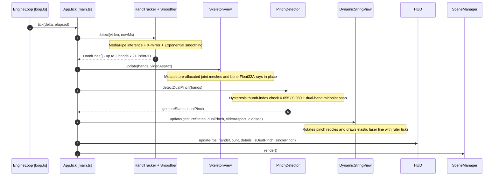

# 🧠 Spatial Harp — Codebase ↔ Application Functionality Mindmap

This document maps every module, class, method, and data contract in the **Spatial Harp** codebase (`src/` and `public/`) to its concrete user-facing behavior.

Related documentation:
- 📚 **[docs/documentation.md](./documentation.md)** — Master architectural specification, milestone roadmap, and walkthroughs.
- 🤖 **[AGENTS.md](../AGENTS.md)** — Architectural rules, zero-GC requirements, and delivery protocols.

---

## 1. Visual Mindmap (Codebase ↔ Functionality)

```mermaid
%%{init: {'flowchart': {'curve': 'linear'}}}%%
flowchart LR
    ROOT["🎵 Spatial Harp (src/main.ts :: App)"]

    %% Branch 1: Vision & Camera Input
    ROOT --> B_VISION["📷 1. Camera & Hand Tracking (Mirrored AR Feed + 21 3D Landmarks)"]
    B_VISION --> V_VID["VideoBackground (src/render/video-background.ts) • Mirrored scaleX(-1) video • object-fit: contain"]
    B_VISION --> V_CAM["CameraManager (src/vision/camera-manager.ts) • 1280x720 getUserMedia stream • Aspect ratio tracking"]
    B_VISION --> V_TRK["HandTracker (src/vision/hand-tracker.ts) • Local WASM (/public/wasm) • Local model (/public/models) • GPU/CPU fallback"]
    B_VISION --> V_SMT["LandmarkSmoother (src/vision/smoothing-filter.ts) • Exponential moving average (alpha=0.75) • Eliminates jitter"]

    %% Branch 2: Gesture Intelligence
    ROOT --> B_GESTURE["🤏 2. Gesture Recognition (Single & Dual-Hand Pinching)"]
    B_GESTURE --> G_PINCH["PinchDetector (src/gestures/pinch-detector.ts) • Thumb (#4) to Index (#8) 3D distance • Hysteresis (0.055 / 0.080) • Dual-hand span"]
    B_GESTURE --> G_TYPES["Gesture & Vision Contracts (src/types/vision.ts, gestures.ts) • HandPose, Point3D, LANDMARK_INDEX • PinchState, DualPinchState"]

    %% Branch 3: 3D AR Visuals
    ROOT --> B_RENDER["✨ 3. 3D WebGL AR Overlay (Skeleton, Reticles & Laser String)"]
    B_RENDER --> R_SCENE["SceneManager (src/render/scene-manager.ts) • OrthographicCamera (-aspect/2..aspect/2) • toWorldCoords() 1:1 alignment"]
    B_RENDER --> R_SKEL["SkeletonView (src/render/skeleton-view.ts) • Pre-allocated 42 red joint circles • Orange-red 1.4x tips • Green bone lines"]
    B_RENDER --> R_STR["DynamicStringView (src/render/dynamic-string-view.ts) • Counter-rotating cyan/white reticles • Elastic laser string & 8-30 ruler ticks"]
    B_RENDER --> R_ANCH["AnchoredStringsView (src/render/anchored-strings-view.ts) • Persistent harp strings • Fret ticks • Glowing end nodes (Zero-GC)"]

    %% Branch 4: Core Engine & Loop
    ROOT --> B_CORE["⚙️ 4. Real-Time 60 FPS Engine (Zero-GC Frame Ticker, Config & Pub/Sub)"]
    B_CORE --> C_CFG["ConfigLoader (src/core/config.ts, public/config.json) • 6 grouped variable batches • localStorage HUD persistence"]
    B_CORE --> C_LOOP["EngineLoop (src/core/loop.ts) • requestAnimationFrame loop • Delta clamping (<=100ms) • 500ms sliding FPS counter"]
    B_CORE --> C_BUS["EventBus (src/core/event-bus.ts) • Typed on / off / emit pub-sub • Decouples vision, gestures & future audio"]

    %% Branch 5: Diagnostics & HUD
    ROOT --> B_UI["📊 5. Diagnostics & Guidance HUD (Live Overlay & Prompts)"]
    B_UI --> U_HUD["HUD (src/ui/hud.ts) • Color-coded FPS badge • Hand count & Left/Right handedness • Gesture status & instructions"]

    %% Branch 6: Instruments Subsystem
    ROOT --> B_INST["🎸 6. Instruments Subsystem (Step 3 Anchoring)"]
    B_INST --> I_MGR["SpatialStringManager (src/instruments/spatial-string-manager.ts) • Anchoring state machine • Harmonic color palette • Up to 12 strings"]
    B_INST --> I_TYP["Instruments Contracts (src/types/instruments.ts) • AnchoredString, SpatialStringConfig"]

    %% Branch 7: Audio Subsystem
    ROOT --> B_AUDIO["🔊 7. Audio & Synthesis Subsystem (Step 4 Audio & Step 6 Presets)"]
    B_AUDIO --> A_ENG["AudioEngine (src/audio/audio-engine.ts) • Multi-synth (Harp, Laser, Chime, 8-Bit) • Adaptive Reverb/Delay FX"]
    B_AUDIO --> A_MAP["ScaleMapper (src/audio/scale-mapper.ts) • Acoustic 3D length-to-pitch mapping (3 octaves C3-E6) • 5 Scales: Pentatonic, Minor, Hirajōshi, Major, Blues"]
    B_AUDIO --> A_COL["StringCollisionDetector (src/gestures/string-collision-detector.ts) • Swept trajectory intersection & velocity"]

    %% Branch 8: Visual Physics & VFX
    ROOT --> B_PHYS["✨ 8. Visual Physics & Sparks (Step 5 Physics & VFX)"]
    B_PHYS --> P_WAV["Harmonic Wave Oscillation (src/render/anchored-strings-view.ts) • 32 subdivisions • Fundamental + 2nd harmonic • Decaying ripple"]
    B_PHYS --> P_SPK["SparkParticlePool (src/render/spark-particle-pool.ts) • 256 GPU Points • Radial contact burst • Gravity & drag"]
    B_PHYS --> P_BLM["UnrealBloomPass (src/render/scene-manager.ts) • EffectComposer • Neon laser halo • Transparent video preservation"]

    %% Branch 9: UI Controls & Settings
    ROOT --> B_SETTINGS["🎹 9. Instrument Controls & Presets (Step 6 Settings)"]
    B_SETTINGS --> S_HUD["HUD Controls (src/ui/hud.ts) • Real-time Glassmorphic Preset & Scale pickers • Instant audio reconfiguration"]

    %% Branch 10: Advanced Plucking VFX & Envelopes (Step 7 Completed)
    ROOT --> B_STEP7["🌟 10. Advanced Plucking VFX & Envelopes (Step 7 Completed)"]
    B_STEP7 --> V_ENV["Dual-Wave Envelope Sheath (src/render/anchored-strings-view.ts) • Spindle oscillation & translucent ribbon"]
    B_STEP7 --> V_RPL["Pluck Contact Shockwaves (src/render/pluck-shockwave-pool.ts) • 3D expanding ripple rings at contact point"]
    B_STEP7 --> V_RET["Precision Sighting Reticles (src/render/anchored-strings-view.ts) • Crosshair endpoints (⌖)"]
    B_STEP7 --> V_MOT["Multi-Form Spark & Mote Pool (src/render/spark-particle-pool.ts) • Explosive sparks & floating ambient motes"]
```

---

## 2. Per-Frame Execution Pipeline (`App.tick` in `src/main.ts`)

Every frame (`~16.6ms` at 60 FPS), functionality flows deterministically through 6 stages:

---

## 3. Codebase ↔ Functionality Reference Matrix

| User-Facing App Functionality | Responsible Codebase File(s) | Key Classes & Methods | Technical Mechanism & Zero-GC Design |
| :--- | :--- | :--- | :--- |
| **Mirrored Selfie Webcam Feed** | [`src/render/video-background.ts`](../src/render/video-background.ts) [`src/vision/camera-manager.ts`](../src/vision/camera-manager.ts) | `VideoBackground.getVideoRect()` `CameraManager.start()` | Captures 1280×720 `MediaStream`, renders directly in a CSS-mirrored (`scaleX(-1)`) `<video>` beneath the transparent WebGL canvas (zero GPU texture upload overhead). |
| **Offline 3D Hand & Finger Tracking** | [`src/vision/hand-tracker.ts`](../src/vision/hand-tracker.ts) [`src/types/vision.ts`](../src/types/vision.ts) `public/models/`, `public/wasm/` | `HandTracker.init()` `HandTracker.detect()` | Loads local MediaPipe WASM and `hand_landmarker.task` with automatic GPU → CPU fallback; mirrors X coordinates (`1.0 - pt.x`) to match the selfie video. |
| **Jitter-Free Landmark Motion** | [`src/vision/smoothing-filter.ts`](../src/vision/smoothing-filter.ts) | `LandmarkSmoother.smooth()` `LandmarkSmoother.reset()` | Applies per-hand, per-joint exponential moving average ($\alpha = 0.75$) in 3D space to suppress camera noise while keeping latency imperceptible. |
| **1:1 AR Coordinate Alignment** | [`src/render/scene-manager.ts`](../src/render/scene-manager.ts) | `SceneManager.toWorldCoords()` `SceneManager.handleResize()` | Uses a normalized `OrthographicCamera` (`top: 0.5, bottom: -0.5`) and computes aspect-corrected world coordinates so 3D overlays lock onto the video regardless of window resize. |
| **21-Joint Red/Green Hand Skeleton** | [`src/render/skeleton-view.ts`](../src/render/skeleton-view.ts) [`src/types/vision.ts`](../src/types/vision.ts) | `SkeletonView.update()` `HAND_CONNECTIONS` | Pre-allocates 42 `CircleGeometry` joint meshes and 2 `LineSegments` bone buffers at startup; highlights thumb (`#4`) and index (`#8`) fingertips at `1.4×` scale. |
| **Flicker-Free Pinch Detection** | [`src/gestures/pinch-detector.ts`](../src/gestures/pinch-detector.ts) [`src/types/gestures.ts`](../src/types/gestures.ts) | `PinchDetector.detectHand()` `PinchDetector.detectDualPinch()` | Measures 3D Euclidean distance between thumb and index tips (`dz` weighted by `0.5`); uses **hysteresis** (`0.055` to engage, `0.080` to release) plus continuous `0..1` pinch strength. |
| **Spinning Fingertip Anchor Reticles** | [`src/render/dynamic-string-view.ts`](../src/render/dynamic-string-view.ts) | `DynamicStringView.update()` | Displays concentric wireframe white outer rings (`+2.0 rad/s`) and glowing cyan inner rings (`-1.5 rad/s`) at each active pinch midpoint. |
| **Elastic Dual-Hand Laser String & Ruler Frets** | [`src/render/dynamic-string-view.ts`](../src/render/dynamic-string-view.ts) | `DynamicStringView.update()` | When both hands pinch (`dualPinch.isDualPinch`), updates a pre-allocated 2-vertex laser line and computes 8–30 perpendicular normal tick marks using pre-allocated scratch vectors (zero GC allocations). |
| **Mid-Air Spatial String Anchoring & Re-Grabbing** | [`src/instruments/spatial-string-manager.ts`](../src/instruments/spatial-string-manager.ts) [`src/types/instruments.ts`](../src/types/instruments.ts) | `SpatialStringManager.update()` `SpatialStringManager.clearAll()` | Dual-pinch release anchoring with 120ms grace window & 350ms cooldown; proximity pinch grabbing on existing string tips ($P_1/P_2$) allowing mid-air repositioning, rotating, and resizing. |
| **Persistent Anchored Harp Rendering** | [`src/render/anchored-strings-view.ts`](../src/render/anchored-strings-view.ts) | `AnchoredStringsView.update()` | Zero-GC rendering of up to 12 persistent strings with glowing anchor end-caps, dynamic grab halo scaling ($1.8\times$), and real-time fret tick updates. |
| **Live Performance & Gesture HUD** | [`src/ui/hud.ts`](../src/ui/hud.ts) [`src/core/loop.ts`](../src/core/loop.ts) | `HUD.update()` `HUD.setMessage()` `EngineLoop` | Glassmorphic vanilla DOM overlay reporting color-coded FPS, active strings counter (`X / 12`), gesture status, and clear controls (`[C]` shortcut and HUD button). |
| **Decoupled Event Infrastructure** | [`src/core/event-bus.ts`](../src/core/event-bus.ts) | `EventBus.on/off/emit` `globalBus` | Ready pub/sub bus decoupling vision, string anchoring, collision pluck events, and Tone.js synthesis. |
| **Fingertip Trajectory Crossing & Pluck Solver** | [`src/gestures/string-collision-detector.ts`](../src/gestures/string-collision-detector.ts) [`src/types/audio.ts`](../src/types/audio.ts) | `StringCollisionDetector.update()` | Swept line-segment anti-tunneling math between moving fingertips (#4, #8, #12) and strings; calculates velocity and contact ratio with a 120ms retrigger shield. |
| **Acoustic Karplus-Strong Audio Engine** | [`src/audio/audio-engine.ts`](../src/audio/audio-engine.ts) [`src/audio/scale-mapper.ts`](../src/audio/scale-mapper.ts) | `AudioEngine.triggerPluck()` `AudioEngine.unlock()` | 8-voice Tone.js PluckSynth pool with logarithmic velocity dynamics, FeedbackDelay, Reverb (2.6s), Limiter, and horizontal spatial X-sorting to C Major Pentatonic (C4-D6). |
| **Harmonic Standing Wave String Physics** | [`src/render/anchored-strings-view.ts`](../src/render/anchored-strings-view.ts) [`src/types/physics.ts`](../src/types/physics.ts) | `AnchoredStringsView.triggerPluck()` | 32-segment line tessellation simulating coupled fundamental + 2nd harmonic standing wave equations along normal vectors with exponential decay (~900ms). |
| **GPU Spark Particle Burst Pool** | [`src/render/spark-particle-pool.ts`](../src/render/spark-particle-pool.ts) | `SparkParticlePool.emitBurst()` `SparkParticlePool.update()` | Zero-GC 256-particle GPU Points pool erupting radial spark bursts from pluck contact points with gravity, velocity drag, and alpha fading. |
| **Neon Sci-Fi UnrealBloom Post-Processing** | [`src/render/scene-manager.ts`](../src/render/scene-manager.ts) | `SceneManager.render()` `EffectComposer` | Post-processing UnrealBloom pipeline with RGBA HalfFloat render targets preserving transparent webcam background while blooming laser strings and sparks. |
